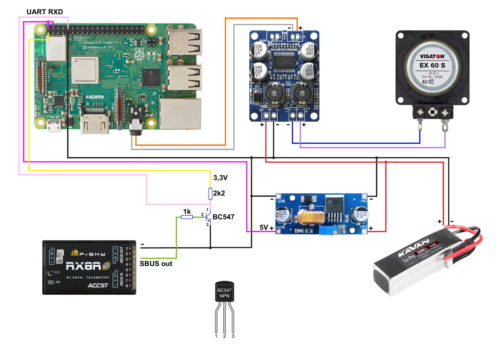
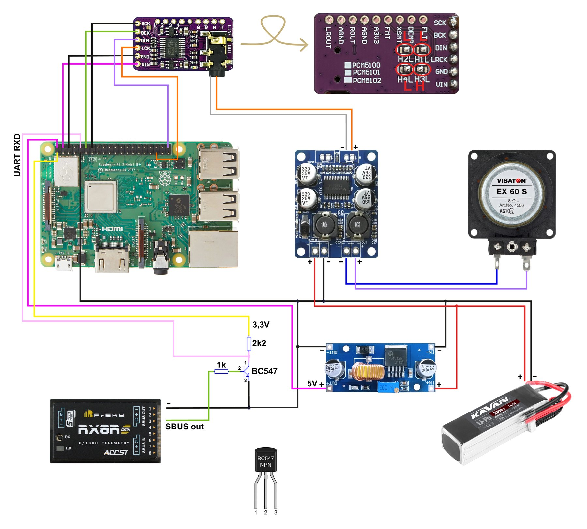

[Česky](README.md) | **English**

# SBusSound – bare metal

Sound module for an RC tank on a **Raspberry Pi 3B+ without an operating
system**. It reads SBus from the receiver and plays the engine with a gearbox,
turret, machine gun, cannon and ambient sounds. It is ready a few seconds after
power-up, there is nothing to install, and cutting the power cannot damage the
card. Built on the [Circle](https://github.com/rsta2/circle) library.

## Ready-made card contents

GitHub builds them after every push: **Actions → latest run → Artifacts →
SBusSound_karta**. Copy the contents of the ZIP to the root of the SD card
(FAT32, MBR partition scheme) and you are done – a set of tank sounds is
included in the `sounds/` folder. Replace any of them with your own under the
same name:

| file | when it plays |
|---|---|
| `motor_start.wav` | once when the engine is switched on |
| `motor_run.wav` | looped while driving, playback rate follows the revs |
| `motor_stop.wav` | once when the engine is switched off |
| `turret.wav` | looped while the turret stick is off-centre |
| `machinegun.wav` | looped while the switch is up |
| `cannon.wav` | once on each flick of the switch |
| `background.wav` | looped while the switch is up |

Sounds can be WAV 8/16/24/32 bit or float, mono or stereo, at any sample rate –
they are converted to 44100 Hz mono when loaded. A missing sound is simply not
played. The easiest way to change them is the `nastaveni.html` page.

**Updating** = replace `kernel8-32.img` on the card with the new one. Settings
and sounds stay.

## Settings

Everything is set in `nastaveni.txt` on the card: output, transmitter
channels, calibration and gearbox. The easier way is the **`nastaveni.html`**
page, which is on the card as well (CZ/EN switch at the top right):

1. Put the card into your computer and open `nastaveni.html` in Chrome or Edge.
2. **Open SD card** → choose the root of the card.
3. Set the channels, choose or edit the sounds (any common format – MP3, M4A,
   FLAC, WAV…), try the gearbox in the engine simulator.
4. **Save to card** writes `nastaveni.txt` and the new sounds straight to the
   card.

The page works in Safari too, but instead of writing to the card it downloads
a ZIP whose contents you copy to the card.

The setting names and values in `nastaveni.txt` are Czech (the engine reads
them); the comments are written in the language the page is switched to.

| setting | meaning |
|---|---|
| `[vystup] zarizeni` | output: `i2s` (PCM5102 module) or `jack` |
| `[vystup] reproduktor` | speaker channel: `oba` (both), `levy` (left), `pravy` (right) |
| `[vystup] hlasitost` | master volume, 0–100 % |
| `[kanaly]` | channel for `motor` (engine), `plyn` (throttle), `vez` (turret), `kulomet` (machine gun), `delo` (cannon), `pozadi` (ambient), `hlasitost` (volume) |
| `[kalibrace]` | `min`, `stred` (centre), `max`; optional `stred_plyn`, `stred_vez` |
| `[prevodovka]` | gearbox: `stupnu` (gears), `pomer` (ratio), `rozjezd`, `dobeh`, `navrat`, `propad`, `zpatecka` (reverse), `max_rychlost` |

## Wiring

A detailed description (in Czech) is also at
[3dprintedtanks.com/zvukovy-modul](https://www.3dprintedtanks.com/zvukovy-modul/).

### Basic version – sound from the Raspberry Pi jack

### DAC version – better and louder sound

Click an image to open the full-resolution PDF.

| Raspberry Pi 3B+ | connect to |
|---|---|
| pin 1 (3.3 V) | through 2k2 to the BC547 collector (leg 1) |
| pin 10 (GPIO15, RXD) | BC547 collector (leg 1) |
| pin 2 (5 V) | step-down converter output **5.0 V** |
| pin 9 (GND) | common ground: step-down, receiver, amplifier, battery |
| pin 4 (5 V) | DAC – VIN |
| pin 6 (GND) | DAC – GND |
| pin 14 (GND) | DAC – SCK |
| pin 12 (GPIO18) | DAC – BCK |
| pin 35 (GPIO19) | DAC – LCK |
| pin 40 (GPIO21) | DAC – DIN |

- **SBus** is inverted, so it goes through a BC547 transistor: the receiver's
  SBUS out through 1k to the base (leg 2), emitter (leg 3) to ground.
- **Power:** a 3- or 4-cell LiPo or Li-Ion battery. Set the step-down converter
  output to **5.0 V before** you connect the Raspberry Pi. The amplifier is
  powered straight from the battery. Use thicker wires for the power lines
  (battery, amplifier, speaker).
- **Sound:** the Raspberry Pi jack (basic version) or the DAC's LINE OUT goes to
  the amplifier input, the speaker to its output (recommended: Visaton EX 60 S,
  screwed or glued firmly to a large flat surface).
- **Solder jumpers on the back of the DAC (GY-PCM5102):** H1L (FLT) = L,
  H2L (DEMP) = L, H3L (XSMT) = **H**, H4L (FMT) = L.
- In `nastaveni.txt`: DAC version `zarizeni = i2s`, basic version `zarizeni = jack`.

## What the LED means

| green LED (ACT) | meaning |
|---|---|
| short blink every second | SBus OK |
| fast blinking | no SBus signal or failsafe |
| 1 long + 2 short | the card cannot be read |
| 1 long + 5 short | not enough memory (sounds too long) |
| 1 long + 6 short | the sound output cannot start |
| 1 long + 7 short | the serial port for SBus cannot be set up |

Errors are also announced by the same number of beeps (when sound works). When
the card holds a file named `diag.txt` (an empty one will do), `log.txt` is
written every 2 s with the loading progress, SBus channels and audio timing –
for debugging only, don't leave it on the card in normal use.

## Building it yourself

    git clone --recursive https://github.com/Luboshort/sbussound-baremetal.git
    cd sbussound-baremetal
    ./sestav.sh          # needs arm-none-eabi-gcc in PATH

The result is in the `vystup/karta/` folder.

## Layout

    src/        source code (C++)
    karta/      config.txt, sample nastaveni.txt, nastaveni.html, sounds/
    docs/       wiring diagrams
    circle/     the Circle library (git submodule, pinned version)
    sestav.sh   builds the kernel and assembles the card contents
