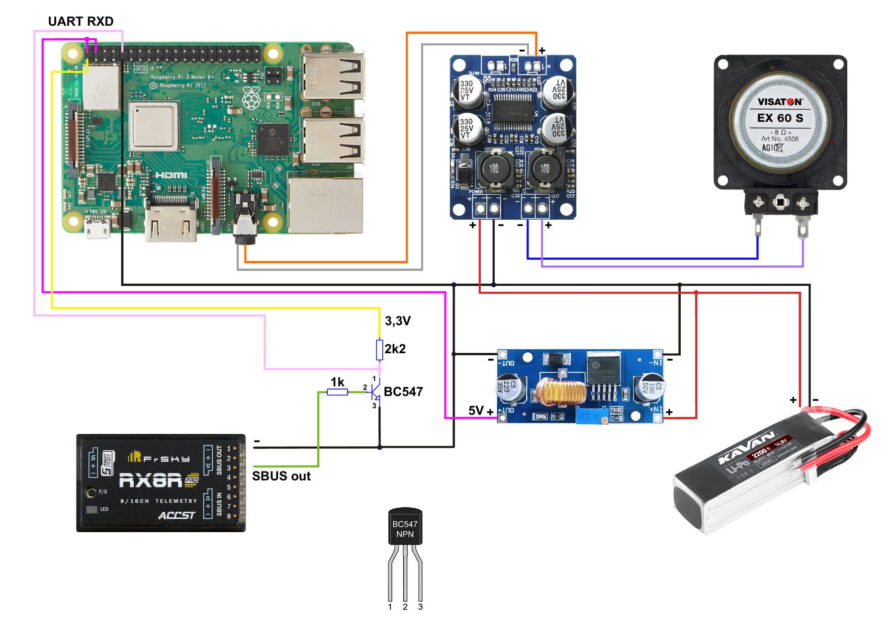
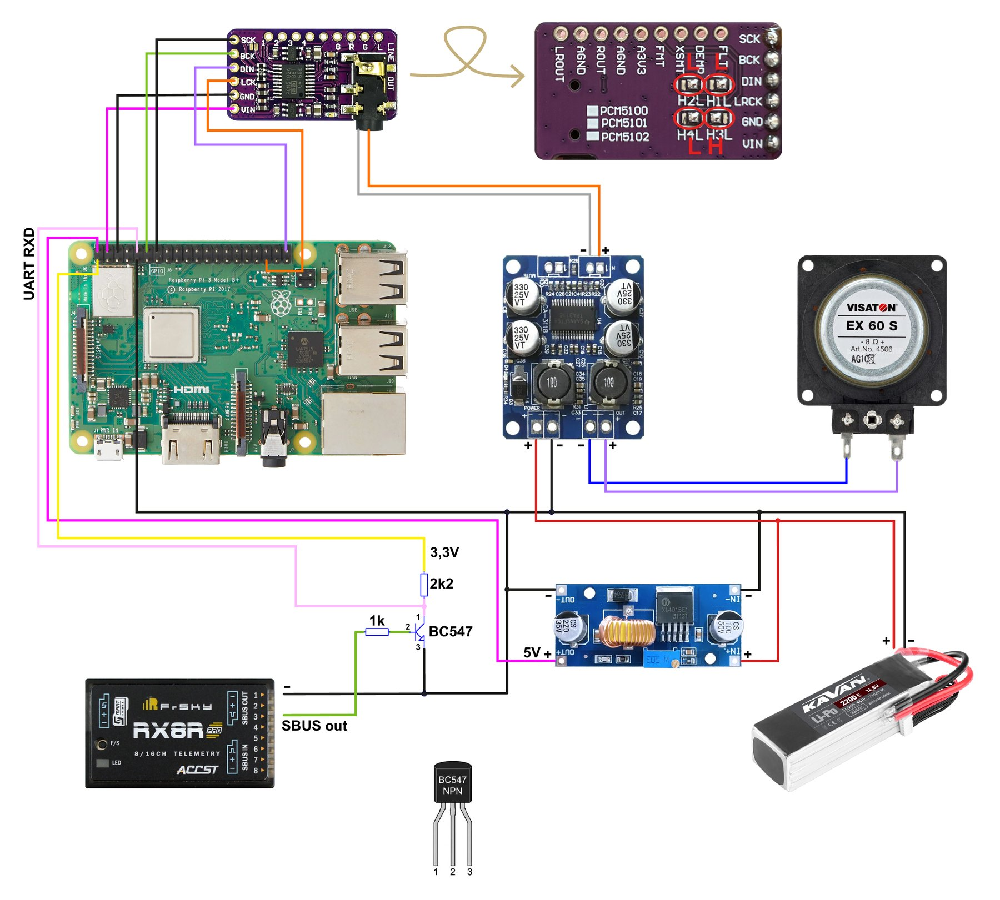

**Česky** | [English](README.en.md)

# SBusSound – bare metal

Zvukový modul pro RC tank na **Raspberry Pi 3B+ bez operačního systému**.
Čte SBus z přijímače a přehrává motor s převodovkou, věž, kulomet, dělo
a zvuky okolí. Naběhne za pár sekund po zapnutí, nic se neinstaluje a kartu
nejde „rozbít“ vypnutím napájení. Postaveno na knihovně
[Circle](https://github.com/rsta2/circle).

## Hotový obsah karty

Po každém pushi ho GitHub sestaví sám: **Actions → poslední běh → Artifacts →
SBusSound_karta**. Obsah ZIPu nakopíruj do kořene SD karty (FAT32, schéma MBR)
a je hotovo – včetně sady zvuků tanku ve složce `sounds/`. Kterýkoli zvuk můžeš
nahradit vlastním se stejným názvem:

| soubor | kdy hraje |
|---|---|
| `motor_start.wav` | jednou po zapnutí motoru |
| `motor_run.wav` | ve smyčce za jízdy, rychlost přehrávání podle otáček |
| `motor_stop.wav` | jednou po vypnutí motoru |
| `turret.wav` | ve smyčce, dokud je páka věže mimo střed |
| `machinegun.wav` | ve smyčce, dokud je přepínač nahoře |
| `cannon.wav` | jednou při každém přepnutí |
| `background.wav` | ve smyčce, dokud je přepínač nahoře |

Zvuky mohou být WAV 8/16/24/32 bit nebo float, mono i stereo, jakákoli
vzorkovací frekvence – při načtení se převedou na 44100 Hz mono. Chybějící
zvuk se prostě nepřehraje. Nejsnáz se mění přes stránku `nastaveni.html`.

**Aktualizace** = přepsat na kartě `kernel8-32.img` novým. Nastavení a zvuky
zůstanou.

## Nastavení

Vše se nastavuje v `nastaveni.txt` na kartě: výstup, kanály vysílače,
kalibrace a převodovka. Pohodlněji to jde stránkou **`nastaveni.html`**, která
je na kartě taky (přepínač CZ/EN vpravo nahoře):

1. Vlož kartu do počítače a otevři `nastaveni.html` v Chromu nebo Edge.
2. **Otevřít SD kartu** → vyber kořen karty.
3. Nastav kanály, vyber nebo uprav zvuky (jakýkoli běžný formát – MP3, M4A,
   FLAC, WAV…), vyzkoušej převodovku v simulátoru motoru.
4. **Uložit na kartu** zapíše `nastaveni.txt` a nové zvuky rovnou na kartu.

V Safari stránka funguje taky, jen místo zápisu na kartu stáhne ZIP, jehož
obsah se nakopíruje na kartu.

Přepínač **Tank / Truck** nahoře mění vzhled stránky a názvy funkcí: u trucku
je z věže **Směr (blinkr)**, z kulometu **Klakson 1** a z děla **Klakson 2**.
Engine ani `nastaveni.txt` se tím nemění.

### Sady zvuků

Tlačítko **Uložit sadu** uloží současné zvuky do podsložky `sounds/<název
sady>/`, **Načíst sadu** nabídne tyto podsložky a zvuky vybrané sady
nakopíruje do `sounds/` místo současných – engine hraje vždy jen soubory
přímo ve `sounds/`. Na kartě je v základu sada **King Tiger II** se stejnými
zvuky jako ve `sounds/`. Volby stránky (Tank/Truck, jazyk, poslední sada) se
ukládají na kartu do `nastaveni_stranky.json`.

## Zapojení

Podrobný popis je také na webu
[3dprintedtanks.com/zvukovy-modul](https://www.3dprintedtanks.com/zvukovy-modul/).

### Základní verze – zvuk z jacku na Raspberry

### Verze s DAC – kvalitnější a hlasitější zvuk

Kliknutím na obrázek se otevře PDF v plném rozlišení.

| Raspberry Pi 3B+ | připojit na |
|---|---|
| pin 1 (3,3 V) | přes 2k2 na kolektor BC547 (nožička 1) |
| pin 10 (GPIO15, RXD) | kolektor BC547 (nožička 1) |
| pin 2 (5 V) | výstup step-down měniče **5,0 V** |
| pin 9 (GND) | společná zem: step-down, přijímač, zesilovač, baterie |
| pin 4 (5 V) | DAC – VIN |
| pin 6 (GND) | DAC – GND |
| pin 14 (GND) | DAC – SCK |
| pin 12 (GPIO18) | DAC – BCK |
| pin 35 (GPIO19) | DAC – LCK |
| pin 40 (GPIO21) | DAC – DIN |

- **SBus** je invertovaný, proto jde přes tranzistor BC547: SBUS out přijímače
  přes 1k na bázi (nožička 2), emitor (nožička 3) na zem.
- **Napájení:** 3–4článková LiPo nebo Li-Ion baterie. Výstup step-down měniče
  nastav na **5,0 V dřív**, než k němu připojíš Raspberry. Zesilovač je
  napájený přímo z baterie. Silové vodiče (baterie, zesilovač, reproduktor)
  dej silnější.
- **Zvuk:** jack Raspberry (základní verze) nebo LINE OUT modulu DAC jde do
  vstupu zesilovače, na jeho výstup reproduktor (doporučený Visaton EX 60 S,
  pevně přišroubovaný nebo přilepený k velké ploše).
- **Propojky na zadní straně DAC (GY-PCM5102):** H1L (FLT) = L, H2L (DEMP) = L,
  H3L (XSMT) = **H**, H4L (FMT) = L.
- V `nastaveni.txt`: verze s DAC `zarizeni = i2s`, základní verze `zarizeni = jack`.

## Co znamená LED

| zelená LED (ACT) | význam |
|---|---|
| krátké bliknutí každou sekundu | SBus v pořádku |
| rychlé blikání | žádný SBus signál nebo failsafe |
| 1 dlouhé + 2 krátká | nejde přečíst karta |
| 1 dlouhé + 5 krátkých | málo paměti (moc dlouhé zvuky) |
| 1 dlouhé + 6 krátkých | nejde spustit zvukový výstup |
| 1 dlouhé + 7 krátkých | nejde nastavit sériový port pro SBus |

Chyby se zároveň ohlásí stejným počtem pípnutí (když zvuk funguje).

## Mapování kanálů

Kanály vysílače se dají přiřadit samy, bez hledání čísel kanálů. Na stránce
`nastaveni.html` v kartě **Nastavování** zapni **Mapovat kanály** a ulož
(v `nastaveni.txt` je to `mapovat = ano` v sekci `[diagnostika]`). Pak vlož
kartu do tanku, zapni vysílač a Raspberry:

1. Jako první hrají dokola stoupající tóny (LED bliká dvakrát za sekundu) –
   otoč ovladačem hlasitosti. Je to zároveň kontrola, že Raspberry čte SBus:
   když se po pohybu nic nestane, signál nepřichází.
2. Od té chvíle ovladač hlasitosti řídí hlasitost dalších zvuků (nejméně
   10 %) a na jinou funkci se už nepřiřadí.
3. Pak dokola hraje zvuk další funkce. Jasně pohni ovladačem, který k ní
   patří – aspoň o 30 % rozsahu, kterýmkoli směrem. Kanál se přiřadí, zvuk
   ztichne a po 3 s ticha začne další.
   Pořadí: hlasitost, `motor_start` (vypínač motoru, `motor_stop` má stejný
   kanál), `motor_run` (páka plynu), `turret`, `machinegun`, `cannon`,
   `background`. Chybějící zvuk nahradí pípání – tolik pípnutí, kolikátý je
   v pořadí.
4. Ovladač, kterým už se pohnulo, se smí vrátit zpět – to se nepočítá.
5. Když vyjde jeden kanál u dvou funkcí, zazní tři hluboké tóny a celé se to
   opakuje.
6. Na konci se kanály zapíšou do `nastaveni.txt` (komentáře zůstanou),
   mapování se vypne (`mapovat = ne`) a Raspberry se restartuje do provozu.

## Log pro nastavování

Když je v `nastaveni.txt` v sekci `[diagnostika]` `log = ano` (na stránce
`nastaveni.html` karta **Log**), zapisuje se každé 2 s na kartu `log.txt`:
hodnoty všech kanálů, jak se načetlo nastavení a zvuky, časování zvuku.
Stránka ho po otevření karty umí zobrazit.

Výpadky signálu mají v logu vlastní seznam (posledních 40, čas od zapnutí):
mezery mezi SBus rámci nad 50 ms, ztracené rámce mezi vysílačem a přijímačem,
failsafe, odskoky hodnot kanálů (poškozená data) a chyby na lince SBus
souhrnně za sekundu. Nahoře je souhrn počtů od zapnutí.

Je to jen pro nastavování a hledání chyb – vypnutí napájení právě během zápisu
může poškodit soubory na kartě. Po nastavení dej zpět `log = ne`, pak se na
kartu nic nezapisuje a napájení jde vypnout kdykoli. (Dřívější soubor
`diag.txt` se už nepoužívá, stránka ho při uložení smaže.)

## Sestavení u sebe

    git clone --recursive https://github.com/Luboshort/sbussound-baremetal.git
    cd sbussound-baremetal
    ./sestav.sh          # potřebuje arm-none-eabi-gcc v PATH

Výsledek je ve složce `vystup/karta/`.

## Struktura

    src/        zdrojový kód (C++)
    karta/      config.txt, vzorové nastaveni.txt, nastaveni.html, sounds/ se zvuky
    docs/       schémata zapojení
    circle/     knihovna Circle (git submodule, pevná verze)
    sestav.sh   sestavení kernelu a složení obsahu karty
